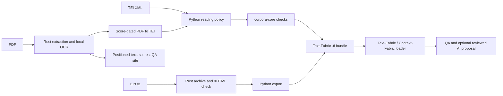

# corpora-core

This repository helps turn source documents into a Text-Fabric (TF) corpus that
other programs can inspect. Think of TF as the book's text plus labeled pointers
to its chapters, headings, notes, links, and other parts. The original TEI,
EPUB, or PDF stays available so a reader can check extracted content.

## Use `corpora-core` from another Rust crate

**Requirements:** Rust 1.91+ and already-decoded UTF-8 text. XML, TEI metadata,
and language checks need no API key or dictionary. In this workspace, add the
dependency to the other crate's `Cargo.toml`:

```toml
[dependencies]
corpora-core = { workspace = true }
```

Then call one check and inspect its report:

```rust
use corpora_core::structural::check_xml;

fn main() -> corpora_core::Result<()> {
    let xml = "<book><title>Example</title></book>";
    let report = check_xml("book.xml", xml)?;
    println!("passed: {}", report.passed());
    Ok(())
}
```

The crate has **no HTTP endpoints**. Its optional `corpora-text-check` CLI reads
one JSON request per line on stdin and writes one response per line on stdout.
See the [core crate integration guide](crates/corpora-core/README.md) for an
external-workspace dependency, the full Rust API, CLI arguments and JSON
operations, and the spelling setup.

**Choose a starting point:**

| I have… | Use… | What it does |
| --- | --- | --- |
| TEI XML | [TEI converter](packages/tei-to-tf/README.md) | Gets local or supported public repository TEI, selects a reading, and exports TF. |
| A local EPUB | [EPUB converter](packages/epub-to-tf/README.md) | Checks the archive, follows its reading order, and exports TF plus assets. |
| A local PDF to convert | [PDF converter](packages/pdf-to-tf/README.md) | Extracts and scores the PDF, converts to TEI and TF only above 95%, and reports located issues. |
| XML text to check in Rust | [corpora-core](crates/corpora-core/README.md) | Reports structural, metadata, language, and optional spelling findings. |
| EPUB bytes to check in Rust | [corpora-convert](crates/corpora-convert/README.md) | Returns source-bound EPUB findings and a reading projection. |
| A local PDF to inspect | [corpora-pdf](crates/corpora-pdf/README.md) | Reads text or OCR, labels layout candidates, and returns visual evidence scores. |
| PDF extraction accuracy to measure | [PDF benchmark](crates/corpora-pdf/benchmarks/README.md) | Compares selected regions against image transcriptions, with character/word error rates, reading-order checks, and model hashes for multilingual runs. |
| TF text to review with AI | [TF AI resolver](packages/tf-ai-resolver/README.md) | Pins a selection, asks the expert for a proposal, and applies an approved derived reading. |
| A shared model in another language | [type generator](crates/corpora-typegen/README.md) | Generates Rust, TypeScript, Swift, and SQL from one schema. |

The optional [quality AI bridge](packages/quality-ai/README.md) helps the TEI
quality pipeline review bounded findings. Build its TypeScript source before
passing `packages/quality-ai/dist/bridge.js` to the converter.
The [Text-Fabric expert bundle](agent/text-fabric-expert/README.md)
contains the agent instructions and evaluation setup.

When the PDF crate is present, PR tests install Poppler, Tesseract and uv (for
the review page's TEI column) before `make ci`, then run the PDF benchmark, review-browser and OCR candidate Python suites.
The [PDF OCR skill](crates/corpora-pdf/skills/pdf-ocr/SKILL.md) and
[proposal](crates/corpora-pdf/agent/PROPOSAL.md) define specialist recognition,
optional paid fallback and location-linked review findings for historical scripts.

## How the pieces fit



Rust decides whether checked source structures are valid under a stated policy.
Python acquires sources and writes conversion bundles. TF stores the text and its
annotations. Context-Fabric loads TF for runtime use; its caches are runtime
data, not part of an exported bundle. AI suggestions cannot approve inconsistent
IDs or silently rewrite the archived wording.

## Get started

Use Rust **1.91 or newer** for the full workspace, Python **3.13 or newer** for
the converter packages, Node **22 or newer** for the optional hosted quality
bridge, and Swift **5.9 or newer** for the generated Swift package. `make doctor`
reports missing local tools. `make setup` installs project dependencies, hooks,
and local configuration; hosted AI credentials are optional for offline work.

```sh
make doctor
make setup
make ci
```

Convert one local EPUB from the repository root:

```sh
cargo build -p corpora-convert --bin corpora-epub-check
uv run --project packages/epub-to-tf epub-to-tf book.epub output/book \
  --checker target/debug/corpora-epub-check
```

Convert one TEI file:

```sh
uv run --project packages/tei-to-tf tei-to-tf book.xml --output output/tei-book
```

Both commands require a **new** output directory. The package READMEs explain
each flag, the supported inputs, the exported files, and how to load the result.

## Project map

| Path | What is ready today |
| --- | --- |
| [`crates/corpora-core`](crates/corpora-core/README.md) | Shared diagnostics, XML/TEI checks, language selection, and optional spelling. |
| [`crates/corpora-convert`](crates/corpora-convert/README.md) | Reusable EPUB validator and `corpora-epub-check` JSON CLI. |
| [`crates/corpora-pdf`](crates/corpora-pdf/README.md) | Reusable local PDF text/OCR and semantic-candidate extraction library and `corpora-pdf-extract` JSON CLI. |
| [`crates/corpora-typegen`](crates/corpora-typegen/README.md) | Schema reader and Rust/TypeScript/Swift/SQL emitters. |
| [`crates/corpora-fabric`](crates/corpora-fabric/README.md), [`crates/corpora-source`](crates/corpora-source/README.md), [`crates/corpora-agent`](crates/corpora-agent/README.md) | Reserved Rust crates; their builder, connector, and runtime APIs are not implemented yet. |
| [`packages/tei-to-tf`](packages/tei-to-tf/README.md) | TEI acquisition, reading policy, TF export, optional quality passes. |
| [`packages/epub-to-tf`](packages/epub-to-tf/README.md) | EPUB export, semantic TF features, asset copying, visual QA. |
| [`packages/pdf-to-tf`](packages/pdf-to-tf/README.md) | Score-gated PDF → TEI → TF, page/line/word mapping, located issue report. |
| [`packages/tf-ai-resolver`](packages/tf-ai-resolver/README.md) | Exact TF selection, expert proposal, reviewed derived reading, loopback browser service. |
| [`packages/quality-ai`](packages/quality-ai/README.md) | Optional hosted model bridge for TEI quality review. |
| [`crates/corpora-core/schema`](crates/corpora-core/schema/README.md), [`packages/corpora-types`](packages/corpora-types/README.md), `generated/`, `Package.swift` | Shared schema, generated types, and SwiftPM library. |
| [`agent/text-fabric-expert`](agent/text-fabric-expert/README.md) | Agent prompt, tools, and evaluation instructions. |

## Public API at a glance

These are the main entry points. Their own READMEs give runnable examples and
parameter tables.

| API | Simple purpose |
| --- | --- |
| `corpora_core::structural::check_xml` / `check_xml_with_options` | Check decoded XML and return exact source locations. |
| `corpora_core::purpose::validate_tei_metadata` | Check TEI dates and IDs according to an explicit caller policy. |
| `corpora_core::language::detect_language` | Select a supported language and dictionary hint. |
| `corpora_core::spellcheck::SpellEngine` | Optionally check spelling with installed, pinned dictionaries. |
| `corpora_convert::epub::validate_epub` / `validate_epub_with_slot_limit` | Check local EPUB bytes and return a reading projection or blockers. |
| `corpora_pdf::extract_pdf` | Extract PDF pages, OCR scans, and return positioned elements with evidence scores. |
| `tei_to_tf.convert` / `epub_to_tf.convert` | Export a new TF bundle from a supported source. |
| `tf_ai_resolver.inspect_selection` / `resolve` / `apply_resolution` | Pin TF text, propose a change, and write a reviewed derived reading. |
| `corpora_typegen::Schema` and target `emit` functions | Read the model schema and generate language-specific types. |

## Development and tests

Work on a `<type>/<slug>` branch and open a Conventional Commit PR into `dev`.
The release path is `dev → next → release/vX.Y.Z → main`; see the
[workflow guide](.github/WORKFLOW.md) and
[branch policy](.github/BRANCH-AND-RELEASE-POLICY.md). Do not edit generated
versions or changelog entries by hand. Keep source, tests, and the matching
README in the same change. The code and agent rules are in [AGENTS.md](AGENTS.md).

```sh
make fmt          # format root Rust and Swift sources
make ci           # root lint, types, tests, and build
make agents-check # agent instructions and skills
make agents-test  # offline Text-Fabric agent contract/config tests
make types        # regenerate shared Rust, TypeScript, Swift and SQL models
make types-check  # verify generated files without modifying them
```

For new or changed shared conversion/model contracts, edit
`crates/corpora-core/schema` first, run `make types`, and commit all generated
outputs with the schema. `make ci` includes the generated freshness check and
offline agent tests. Missing, changed or extra generated files fail CI; CI does
not rewrite or commit them. All package-publishing jobs wait for the same check.

Root `make ci` does **not** discover nested Python and Node packages. Run their
own checks when you change them:

```sh
make -C packages/tei-to-tf check build
uv run --project packages/epub-to-tf pytest -q packages/epub-to-tf/tests
uv run --project packages/tf-ai-resolver pytest -q packages/tf-ai-resolver/tests
cargo build -p corpora-pdf --bin corpora-pdf-extract
make -C packages/pdf-to-tf check build
npm ci --prefix packages/quality-ai
npm run check --prefix packages/quality-ai
npm run build --prefix packages/quality-ai
npm test --prefix packages/quality-ai
```

The [TEI package workflow](.github/workflows/tei-converter.yml),
[PDF converter workflow](.github/workflows/pdf-converter.yml) and
[EPUB/resolver workflow](.github/workflows/epub-resolver.yml) run their nested
checks on relevant PRs, including shared schema/generator, generated output and
Text-Fabric agent/skill changes. See each package README for its complete locked
check command and real-loader verification.

## Contributing and license

Start with [AGENTS.md](AGENTS.md), change only the relevant module, and add a
test when behavior changes. Keep secrets out of code, examples, and commits;
see the [workflow guide](.github/WORKFLOW.md) for local setup and PR rules.
The repository is licensed under **MIT OR Apache-2.0**.

For a new Rust crate, run `cargo new crates/corpora-mycrate --lib`, inherit the
workspace package fields and lints in its `Cargo.toml`, add a focused README,
and verify it with `make ci`. Reserved crate names in the project map are not
working APIs until code and tests are added.

## Publishing

Release automation handles versions and tags. `PUBLISH_CRATES=true` opts the
tagged release into crates.io publishing when `CARGO_REGISTRY_TOKEN` is
configured in the `crates` environment. Workspace crates depend on each other
through versioned `path` entries in the root `[workspace.dependencies]`, which
the release version bump keeps in step, so `cargo package` can publish them. `PUBLISH_GITHUB_PACKAGES=true` opts
into generated TypeScript package publishing; the release also carries Cargo
artifacts, and the root `Package.swift` exposes generated Swift types. Follow
the [branch and release policy](.github/BRANCH-AND-RELEASE-POLICY.md) before
changing publishing settings.

The PDF QA builder renders source pages to PNG at the extraction coordinate scale,
so the internal browser does not need a PDF plugin. Findings are collapsed by
default and script findings link to their extracted element. Original PDFs and
raw JSON remain available; the viewer never applies OCR candidates.
A third column renders the TEI that `pdf-to-tf` builds from the same extraction
as HTML, labelled by semantic type; `--no-tei` skips it (it needs `uv`).

The bounded PDF OCR candidate tool is `crates/corpora-pdf/tools/ocr_review.py`.
Run its credential-free tests with `python3 -m unittest discover -s crates/corpora-pdf/tools -p 'test_*.py'`.
It preserves source text and emits review-required candidates; hosted recognition
requires explicit provider selection and a request cap. Use `--provider vercel`
with `AI_GATEWAY_API_KEY` (preferred), or `--provider mistral` with `MISTRAL_API_KEY`.
Gateway requests preserve reported token usage, exclude reference text and have no
client retries; cached candidates remain subject to image review. The first cache
miss checks authenticated model eligibility before inference. Use `--gateway-model`
for explicit model selection; the tool respects existing team provider allowlists.
Direct Mistral OCR also retains validated `usage_info` page/byte counters and
the reported OCR model in successful caches and rejected-response reports.
Missing usage stays unknown; cached counters describe the original request.
Rejected JSON responses retain sanitized finish reasons and token usage when supplied,
including reasoning-token counts; partial text is rejected and is never cached as a candidate.
`--gateway-reasoning-effort low|high` explicitly selects a catalog-supported effort
for Vercel and separates its cache; omitting it preserves the existing request defaults.
`--gateway-max-tokens N` (1–32768, default 1024) sets the Vercel output cap; a non-default
cap must fit the catalog's advertised model limit and uses a separate cache.
