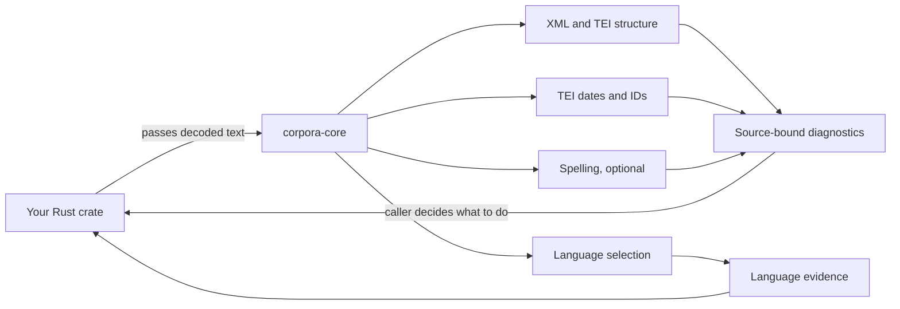

# corpora-core: reusable text checks

Give this Rust crate text. It gives you a report saying **what needs attention**
and **where it is**. It never changes the text. Other crates can use it to check
XML/TEI structure, TEI metadata, and language; spelling is optional. The
[TEI converter](../../packages/tei-to-tf/README.md) uses these checks before
exporting a Text-Fabric bundle.

## Requirements and installation

- Rust **1.91+** for this crate; pass already-decoded UTF-8 text to its APIs.
- No server, API key, or dictionary is needed for XML, metadata, or language checks.
- For spelling, enable the `spellcheck` feature and install dictionary data separately.

In this repository, the root `Cargo.toml` already declares `corpora-core` in
`[workspace.dependencies]`. Add this to the **consuming crate's** `Cargo.toml`:

```toml
[dependencies]
corpora-core = { workspace = true }
```

For a crate in another workspace, use a path to this checkout instead, for
example `corpora-core = { path = "../corpora-core/crates/corpora-core" }`.
Add `features = ["serde"]` when serializing reports, or
`features = ["spellcheck"]` for spelling and the CLI.



## Try it from another Rust crate

```rust
use corpora_core::structural::{check_xml_with_options, StructuralOptions};

fn main() -> corpora_core::Result<()> {
    let xml = "<TEI xmlns='http://www.tei-c.org/ns/1.0'/>";
    let report = check_xml_with_options(
        "book.xml",
        xml,
        StructuralOptions { tei: true, ..Default::default() },
    )?;
    for issue in &report.diagnostics {
        eprintln!("{}: {}", issue.code, issue.message);
    }
    println!("passed these checks: {}", report.passed());
    Ok(())
}
```

`book.xml` is the identity you assign to this exact input. `passed()` means
**these selected checks** found no blocker; it does not mean full TEI schema
validation or that conversion will succeed.

## Pick a check

| API | Parameters | Returns | Purpose |
| --- | --- | --- | --- |
| `structural::check_xml(source_id, text)` | Your source name; decoded UTF-8 XML | `DiagnosticReport` | Check strict XML with default limits. |
| `structural::check_xml_with_options(source_id, text, options)` | Same inputs plus `StructuralOptions` | `DiagnosticReport` | Set byte/node budgets; optionally check TEI boundaries. |
| `purpose::validate_tei_metadata(source_id, xml, expected_document_id, allow_no_namespace)` | Source name, TEI XML, optional caller ID, namespace policy | `PurposeReport` | Check metadata dates and primary ID, keeping field receipts. |
| `language::detect_language(text, hint)` | Text and optional locale hint | `LanguageDetection` | Pick a supported language/dictionary or say why none fits. |
| `SpellEngine::load(root)` / `load_selected(root, names)` | Installed dictionary directory; optional allowed names | `SpellEngine` | Open dictionary data when `spellcheck` is enabled. |
| `SpellEngine::check(text, role, hint)` | Decoded text, `TextRole`, optional locale | `SpellReport` | Report language and spelling findings. |
| `SpellEngine::check_diagnostics(source_id, text, role, hint)` | Same text plus source name | `DiagnosticReport` | Get spelling findings in the shared diagnostic format. |

`source_id` is your label for this exact input. `expected_document_id` is a
caller-supplied identity expectation, **not** an ID guessed from a filename.
`hint` may be `Some("en-GB")`, for example, or `None` to detect from text.
Every function above returns `Result<...>` except the shown report methods.

`StructuralOptions` defaults to 64 MiB of UTF-8 and 1,000,000 parser nodes;
set `tei: true` for additional TEI checks. `allow_no_namespace` defaults to
`false`. `TextRole` has `Corpus`, `Metadata`, `Frontmatter`, `Footnote`,
`Additional`, and `Heading` variants. The spelling feature requires Rust 1.91
and separately installed dictionaries.

Enable `serde` to serialize shared types; enable `spellcheck` for the Matchum
spelling engine and the `corpora-text-check` JSON-lines executable. The basic
XML, TEI metadata, language, and diagnostic APIs do not require dictionaries.

## Diagnostic helpers

| Method | Purpose |
| --- | --- |
| `DiagnosticReport::new(source_id, text, findings)` | Bind findings to the SHA-256 of this exact UTF-8 text. |
| `DiagnosticReport::passed()` | Check whether any finding is blocking. |
| `DiagnosticReport::matches_source(text)` | Refuse stale ranges if the text has changed. |
| `SourceRange::from_bytes(text, start..end)` | Convert a UTF-8 byte span to byte, scalar, line, and column positions. |
| `TextEdit::matches_source(report, text)` | Check that a suggested edit still matches the report's source and old text. |

The detailed sections below explain the policies and coordinates.

## Shared structural and spelling diagnostics

Rust callers can check XML directly without Python, dictionaries, or the `spellcheck`
feature. `structural::check_xml` uses a strict namespace-aware parser with no recovery,
DTD loading, external entity resolution or network access:

```rust
use corpora_core::structural::check_xml;

fn main() -> corpora_core::Result<()> {
    let source = "<root><title>Example</Title></root>";
    let report = check_xml("edition.xml", source)?;
    assert!(!report.passed());
    let proposal = &report.diagnostics[0].suggestions[0].edits[0];
    assert!(proposal.matches_source(&report, source));
    assert_eq!(proposal.after, "</title>");
    Ok(())
}
```

With `spellcheck`, use
`SpellEngine::check_diagnostics(source_id, text, role, locale_hint)` for the same
`diagnostic::DiagnosticReport` type. `SpellEngine::check` and its existing JSON shape
remain unchanged. Spelling coordinates refer to the exact supplied **decoded text
segment**, not to raw XML; callers must retain the segment-to-document mapping.

The version-1 shared contract includes caller-supplied source identity, a SHA-256 of
the exact UTF-8 input, issue code/category, explanation, certainty, severity,
blocking status, optional policy score, locations and suggestions. Locations contain
zero-based UTF-8 byte and Unicode scalar offsets and one-based line/scalar columns.
Ranges are half-open; LF starts a new line and CRLF is retained in offsets. Multiple
locations support related findings such as duplicate IDs. Empty locations explicitly
mean the parser cannot supply an exact location; no synthetic line 1 is advertised.

Suggestions include an explanation, `automatic` or `review` applicability, and zero
or more exact before/after edits. Empty edits mean guidance rather than a defensible
replacement. `automatic` permits an automated **attempt under caller policy**, not
unconditional approval. Dictionary misses remain possible issues, even when policy
scores them 90; scores are never confidence percentages. Structural parser/policy
failures are certain findings, but their proposed remedies can still require review.

The core never applies these edits. The API layer checks `TextEdit::matches_source`,
rejects overlapping/conflicting edits, applies a chosen candidate to a separate copy,
then reruns all required validation. Recheck after every batch: every edit in a report
uses the unchanged source snapshot. Retain originals and record decisions, including
legitimate names/spellings accepted by contextual review. Corpus spelling candidates
always require contextual assessment; no corpus rewrite is automatically approved.

`check_xml_with_options` sets byte/node limits (defaults 64 MiB / one million nodes).
Set `StructuralOptions { tei: true, ..Default::default() }` to additionally check TEI
root/namespace, duplicate `xml:id`, XInclude, `copyOf`/`spanTo`, and selected unsupported
transcription/stand-off adapter boundaries. Namespace-free TEI needs explicit opt-in.
These are bounded adapter checks, **not full TEI P5/RNG/XSD validation**, editorial
reading selection, or conversion parity with the Python package. Clean structural
reports do not imply that conversion, schema checks or spelling will pass.

The XML parser reports the first syntax error; repair and revalidation can reveal
further errors. Case-only closing-tag mismatches expose an exact candidate correction;
ambiguous mismatches and undefined entities provide guidance. Malformed ampersands
offer a review candidate because a broken entity reference may need a different fix.
Comments, CDATA, processing instructions and valid references are parsed as such.
Inputs must already be decoded to UTF-8; hashes cover those bytes, not an earlier
file encoding. Original-source acquisition, projection, schema validation and repair
orchestration still live in Python and can migrate independently.

```sh
cargo test --locked -p corpora-core --no-default-features
cargo test --locked -p corpora-core --all-features
```

## Language and spelling

### Purpose-aware TEI dates and identifiers

`purpose::validate_tei_metadata(source_id, xml, expected_document_id, allow_no_namespace)`
works without dictionaries or the `spellcheck` feature. It returns the shared,
source-hashed diagnostics plus `PurposeField` receipts for recognized metadata fields:

```rust
use corpora_core::purpose::validate_tei_metadata;

fn main() -> corpora_core::Result<()> {
    let xml = "<TEI xmlns='http://www.tei-c.org/ns/1.0'><teiHeader><date>2014</date></teiHeader></TEI>";
    let result = validate_tei_metadata("edition.xml", xml, None, false)?;
    assert!(result.report.passed());
    assert_eq!(result.fields.len(), 1);
    Ok(())
}
```

Only qualified TEI `date`/`idno` elements within metadata scopes are routed this way;
reading-text and foreign-namespace fields are left to their existing checks.
Namespace-free TEI requires explicit opt-in. Nested child markup is blocked rather
than flattened into a structured value. Original XML ranges (UTF-8 bytes, scalars,
line/column), decoded values, zero-based element-child locators and validation status
are retained. `policy_version`, `expected_document_id` and `allow_no_namespace` bind
the receipt to the caller's policy as well as its source snapshot.

The bounded date policy accepts nonzero four-digit years, ordered numeric year ranges
(`1868-1873` or an en dash), `YYYY-MM` and valid `YYYY-MM-DD` Gregorian dates. It checks
`when`, `from`, `to`, `notBefore` and `notAfter` for valid forms and a consistent
interval, including consistency with text at its stated precision. Missing values,
invalid leap days, reversed/conflicting bounds, unsupported text, explicit calendar/
dating-system attributes and ISO/custom dating extensions remain blocked. A bounded
numeric date check is not full TEI schema validation or historical fact verification.

Identifier expectations are supplied by the caller; core never derives one from a
filename. An expectation applies only to an untyped primary
`TEI/teiHeader/fileDesc/publicationStmt/idno` in a single root TEI document. Values are
trimmed for comparison, must be nonempty and have no internal whitespace. Typed IDs
(including ISBN), other scopes and collection-member IDs need a dedicated policy and
remain blocked. A mismatch is evidence of inconsistency with the caller's expectation,
not proof that the source is wrong. Suggestions require review of the expectation and
references and contain **no automatic identifier edits**.

The JSON-lines bridge supports this operation without loading dictionaries:

```json
{"operation":"purpose","source_id":"edition.xml","expected_document_id":"edition","text":"<TEI xmlns='http://www.tei-c.org/ns/1.0'><teiHeader><date>2014</date></teiHeader></TEI>"}
```

Rebuild `corpora-text-check` before using the Python adapter with the new operation.
The adapter checks complete field coverage, policy/source bindings and all coordinates
before excluding typed fields from language/spelling. Every final candidate is checked
again; failed purpose findings cannot be cleared by spelling AI or correction maps.

`language::detect_language(text, locale_hint)` returns the selected locale,
confidence, detection method, allowed cspell dictionary directory, alternatives,
and whether the region is a default. Unknown/short or unsupported text does not
silently select English. Generic `en` defaults to `en-US`; use `en-GB`/`en-CA`
for a regional choice. French defaults to traditional `fr_FR`; `fr-FR-1990`
selects `fr_FR_90`. Ancient Greek requires `grc`; statistical Greek detection
cannot reliably distinguish historical periods. `en_shared` and `public-licenses`
are supplemental resources, not languages.

The optional `spellcheck` feature exposes `SpellEngine`, backed by the published
Matchum dictionary crate 0.0.1. This crate requires Rust 1.91. Dictionary data is
installed separately; it is not embedded or fetched during library calls.

```rust
use std::path::Path;
use corpora_core::{language::detect_language, spellcheck::{SpellEngine, TextRole}};

fn main() -> corpora_core::Result<()> {
    let text = "Bonjour le monde";
    let language = detect_language(text, Some("fr-FR"))?;
    println!("selected locale: {}", language.locale);

    let engine = SpellEngine::load(Path::new("target/cspell-dictionaries"))?;
    let report = engine.check_diagnostics("paragraph-1", text, TextRole::Corpus, Some("fr-FR"))?;
    println!("blocking spelling findings: {}", !report.passed());
    Ok(())
}
```

Enable `corpora-core`'s `spellcheck` Cargo feature for this example. For only
language detection, import `detect_language` and omit `SpellEngine`; no
dictionaries are needed. `load_selected(root, &["en_US"])` loads a named
subset. Use `check(text, role, hint)` if you need the older `SpellReport`
shape instead of shared diagnostics.

```sh
python3 crates/corpora-core/tools/install_dictionaries.py --output target/cspell-dictionaries
cargo build --locked -p corpora-core --features spellcheck --bin corpora-text-check
```

The installer uses `tools/dictionaries.lock.json`: pinned npm versions and SHA512
archive integrity, plus a commit/SHA256 pin for unpublished `en_shared`. It executes
no npm scripts and retains license files shipped by packages. Add repeated
`--dictionary en_US` options for a subset. Existing install directories are refused.
The runtime validates each artifact's SHA256 and supports cspell TrieXv3/text/gzip,
case sensitivity, forbidden-word policy, and replacement maps. It does not claim
full cspell CLI/config or weighted-suggestion parity. Only the 15 requested
resources are allowed; Canadian config references outside that list are not loaded.

## CLI: one JSON request per line

`corpora-core` has **no HTTP endpoints**. The optional `corpora-text-check` CLI
is its process boundary for Python or other non-Rust callers. It reads one JSON
object per line from standard input and writes one JSON object per line to
standard output.

| CLI argument | Meaning |
| --- | --- |
| No argument | Structure, purpose, and language detection work without dictionaries. |
| `[DICTIONARY_DIR]` | Optional first positional path, such as `target/cspell-dictionaries`; enables spelling for ordinary text requests. |

```sh
cargo build --locked -p corpora-core --features spellcheck --bin corpora-text-check
printf '%s\n' '{"operation":"structure","source_id":"book.xml","text":"<root/>"}' \
  | target/debug/corpora-text-check
```

| `operation` in JSON | Required and useful fields | Output |
| --- | --- | --- |
| `"structure"` | `text`; optional `source_id` | `DiagnosticReport` from `check_xml` with default limits. |
| `"purpose"` | `text`; optional `source_id`, `expected_document_id`, `allow_no_namespace` | `PurposeReport` for TEI dates and primary ID. |
| Omitted | `text`; optional `locale`, `role`, `detect_only`, `supplements` | Language evidence; with a dictionary directory, spelling findings unless `detect_only` is true. |

`text` is always required. `source_id` defaults to `<input>`. The CLI's structure
operation uses `check_xml`, so call the Rust library when you need custom
`StructuralOptions` such as `tei: true`. Errors are JSON objects with `error`;
check each line before using it.

An ordinary text request without a dictionary directory detects language only.
With the directory argument it lazily loads the selected language dictionary:

```json
{"text":"hello world","locale":"en-US","role":"corpus"}
```

Structural requests use the shared version-1 report and need no dictionaries:

```json
{"operation":"structure","source_id":"edition.xml","text":"<title>Example</Title>"}
```

The structural operation works with or without a dictionary directory. Requests
without `operation` retain the existing detection/spelling response shapes. Python's
quality/preview adapter consumes these Rust reports, verifies their source hashes
and coordinates, and rechecks each repaired candidate through core. It fails closed
with an older executable that lacks the versioned structural operation.

`role` is `corpus`, `metadata`, `frontmatter`, `footnote`, `additional`, or `heading`.
`detect_only: true` requests just the language payload even with dictionaries
configured. Errors are JSON objects with `error`; callers must check them.
Optional `supplements: ["en_shared", "public-licenses"]` loads those resources too;
shared English words apply only to English. Library callers can select them with
`SpellEngine::load_selected`.
Legacy spelling JSON offsets are **Unicode scalar offsets within the supplied text**;
the shared diagnostic report also supplies UTF-8 byte and line/column positions.
Scores are policy severity, not confidence probabilities:

| Finding | Score | Pass | Repair |
| --- | --- | --- | --- |
| Heading, all-caps or initial capital | 20 | Yes | Flag and ignore |
| Other corpus spelling / suspicious typography | 60 | Yes | AI suggestion; no automatic corpus edits |
| Other non-corpus spelling | 90 | No | Core supplies dictionary candidates; quality pipeline requires AI review and revalidation |

Literal source text cannot invoke cspell directives. Every occurrence is checked.
Capitalized words can match lowercase dictionary entries without changing the text.
The engine never applies its replacements itself; the converter owns the audited
repair/revalidation passes. Proper names and ambiguous suggestions are not silently
rewritten. For the converter workflow see `packages/tei-to-tf/README.md`.


### Large compressed dictionaries

Matchum 0.0.1 expands TrieXv3 shared nodes into a hash dictionary. The pinned Hebrew, Italian and Latin
resources represent about 107 million, 45 million and 19 million terminal paths,
respectively. `compact_trie.rs` adapts Matchum's MIT-licensed parser and
implements its public `Dictionary` interface while retaining the shared trie.
Exact lookup is bounded by word length; suggestions use bounded single-edit
dictionary-alphabet candidates rather than scanning the expanded word set. These suggestions are
not identical to Matchum's ranked full-dictionary suggestions. The original license
and pinned upstream attribution are retained in `tools/MATCHUM-LICENSE` and source.
The adapter is limited to these three resources and rejects unsupported compound
or suggestion metadata; other dictionaries use Matchum's
published loaders, configuration maps and suggestion implementation.

## License

MIT OR Apache-2.0
